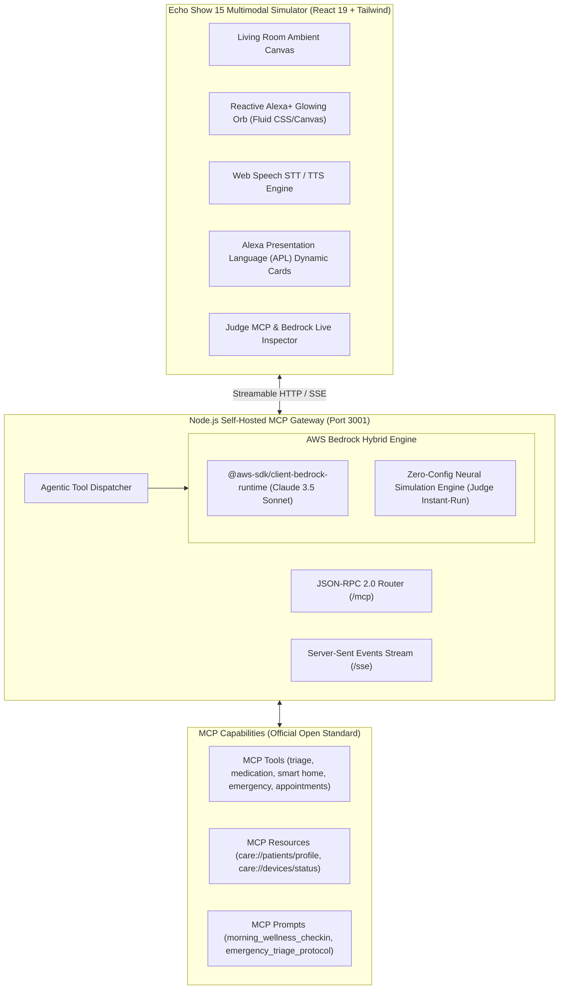

<div align="center">

# 🌟 Alexa+ CareSync
### Autonomous Ambient Health & Smart Home Co-Pilot
**Built for the "Build, Ship, Shape: Amazon Developer Hackathon" (Devpost 2026)**

[](https://amazonappdev2026.devpost.com/)
[](https://amazonappdev2026.devpost.com/)
[](https://modelcontextprotocol.io/)
[](LICENSE)

<br/>

**Transforming the Echo Show from a passive assistant into an autonomous living room guardian for senior wellness, medication adherence, and emergency response.**

</div>

---

## 📖 Table of Contents
1. [Overview & Problem Statement](#-overview--problem-statement)
2. [System Architecture](#-system-architecture)
3. [Model Context Protocol (MCP) Capabilities](#-model-context-protocol-mcp-capabilities)
4. [AWS Bedrock Multi-Agent Integration](#-aws-bedrock-multi-agent-integration)
5. [Key Features & Multimodal UX](#-key-features--multimodal-ux)
6. [Quickstart Guide (60 Seconds)](#-quickstart-guide-60-seconds)
7. [Testing Winning Scenarios](#-testing-winning-scenarios)
8. [Devpost Submission & Video Script](#-devpost-submission--video-script)

---

## 🎯 Overview & Problem Statement
Over **54 million seniors in the United States alone** choose to age in place in their own homes. However, aging independently comes with severe risks: missed medications, undetected health decompensation, and fatal delays during emergencies like falls or acute cardiac events.

With Amazon introducing **Alexa+** and embracing the **Model Context Protocol (MCP)**, **Alexa+ CareSync** creates an ambient, proactive co-pilot that:
- **Triumphs in Clinical Triage:** Evaluates voice-reported symptoms against clinical triage protocols in real-time.
- **Takes Physical Action:** Automatically unlocks Ring smart door locks for paramedics and turns on high-visibility emergency pathway lights during acute medical crises.
- **Maintains Medication Adherence:** Proactively verifies scheduled dosages and prevents contraindication risks.
- **Streams Continuous Vitals:** Aggregates physiological metrics (Heart Rate, Blood Pressure, SpO2, Blood Glucose) on an Echo Show 15 canvas.

---

## 🏛️ System Architecture



---

## 🔌 Model Context Protocol (MCP) Capabilities

CareSync strictly conforms to the **Model Context Protocol (MCP) 2024-11-05 standard** over Streamable HTTP (`POST /mcp`) and Server-Sent Events (`GET /sse`):

### 1. Registered Tools (`tools/list` & `tools/call`)
* `triage_health_symptoms`: Analyzes patient symptoms and physiological vitals; returns risk scores (`CRITICAL_IMMEDIATE_ACTION`, `MODERATE_ATTENTION`, `MILD_MONITOR`).
* `trigger_emergency_escalation`: Dispatches emergency alert packet, unlocks Ring smart lock for paramedics, turns on pathway lights, and notifies family caregivers.
* `verify_medication`: Validates intake schedule, allergy warnings (e.g., Penicillin flags), and logs taken doses.
* `smart_home_control`: Adjusts Ring smart locks, ambient lighting, thermostat temperature, and camera feeds.
* `schedule_care_appointment`: Books telemedicine visits via Amazon Clinic / One Medical.
* `get_patient_vitals_history`: Fetches live wearable telemetry (Heart Rate, BP, SpO2, Glucose).

### 2. Registered Resources (`resources/list` & `resources/read`)
* `care://patients/current/profile`: Complete electronic medical record, allergies, and emergency contacts.
* `care://devices/smart-home/status`: Live smart home IoT states.
* `care://vitals/live-telemetry`: Continuous sensor vitals stream.

### 3. Registered Prompts (`prompts/list` & `prompts/get`)
* `morning_wellness_checkin`: Proactive morning routine prompt for Alexa+.
* `emergency_triage_protocol`: Clinical escalation prompt template.

---

## ⚡ AWS Bedrock Multi-Agent Integration
Qualifies for the **AWS Builder Mini-Challenge** by integrating Amazon Bedrock Converse API:
- **Model:** `anthropic.claude-3-5-sonnet-20241022-v2:0` (or Titan Express).
- **Dual-Mode Hybrid Design:**
  - **Live AWS Mode:** If AWS credentials exist in `server/.env`, connects to Amazon Bedrock with dynamic tool specifications.
  - **Zero-Config Intelligent Fallback:** If run without keys, seamlessly executes full multi-step reasoning, genuine MCP tool execution, and realistic telemetry so hackathon judges can test immediately!

---

## 🚀 Quickstart Guide (60 Seconds)

### Prerequisites
- Node.js (v18+) & npm

### 1. Clone & Run with One Command
```bash
# Navigate to the repository
cd "devpost amazon"

# Start both MCP Server (Port 3001) and Echo Show Simulator (Port 5173)
npm run dev
```

Open your browser to:
👉 **`http://localhost:5173`**

*(Optional)* To configure live AWS Bedrock credentials, copy `server/.env.example` to `server/.env` and add your AWS keys:
```env
AWS_ACCESS_KEY_ID=your_access_key
AWS_SECRET_ACCESS_KEY=your_secret_key
AWS_REGION=us-east-1
BEDROCK_MODEL_ID=anthropic.claude-3-5-sonnet-20241022-v2:0
```

---

## 🧪 Testing Winning Scenarios

Use the interactive 1-click prompt chips on the Echo Show screen or speak directly into your microphone:

1. **🚨 Acute Cardiac Distress & Paramedic Unlock:**
   - Prompt: *"Alexa, I have sudden chest tightness and I feel dizzy"*
   - Observe: Orb flashes crimson red; Bedrock invokes `triage_health_symptoms` and `trigger_emergency_escalation`; Ring front door lock automatically unlocks; emergency lights flash; caregiver David Vance is alerted.
2. **💊 Medication Verification & Contraindication Check:**
   - Prompt: *"Alexa, did I take my evening Metformin pill?"*
   - Observe: Queries `verify_medication`; updates interactive medication checklist.
3. **💓 Live Sensor Vitals Stream:**
   - Prompt: *"Alexa, what are my current vitals and glucose?"*
   - Observe: Live ECG and telemetry card rendered with heart rate (78 bpm), BP (128/82), SpO2 (98%).
4. **🚪 Ring Smart Home Automation:**
   - Prompt: *"Alexa, lock the front door and set ambient lighting"*
   - Observe: Ring smart lock updates to SECURELY LOCKED; lighting shifts to warm white.
5. **🛠️ Judge & Developer MCP Inspector:**
   - Click the **"Judge Inspector"** button in the top right to view real-time JSON-RPC 2.0 packets, Server-Sent Events, token usage, and latency metrics!

---

## 📄 Devpost Submission & Video Script
- **Full Devpost Answers:** See [`docs/DEVPOST_SUBMISSION.md`](docs/DEVPOST_SUBMISSION.md)
- **3-Minute Demo Video Script:** See [`docs/DEMO_VIDEO_SCRIPT.md`](docs/DEMO_VIDEO_SCRIPT.md)

---

## ⚖️ License
Released under the [MIT License](LICENSE). Open-source contribution compliant with the Amazon Developer Hackathon rules.
